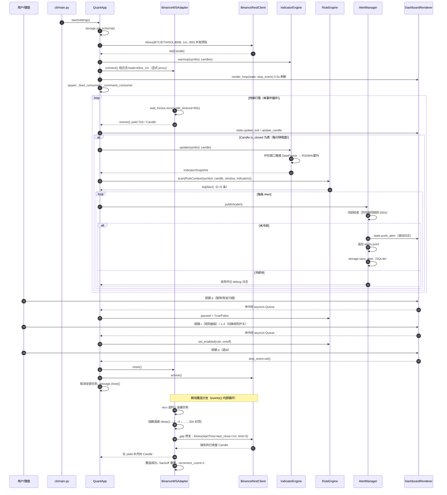
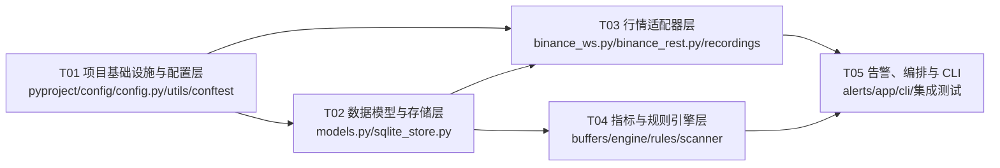

# 量化程序（quant_trading）系统设计与任务分解

> 版本：v1.0 ｜ 作者：架构师 高见远（Gao） ｜ 日期：2025-10-24 ｜ 上游输入：`docs/PRD.md` v1.0
>
> 配套图表：`docs/class-diagram.mermaid`、`docs/sequence-diagram.mermaid`（本文件第 3、4 节内嵌同内容）

---

## Part A：系统设计

### 1. 实现方案与框架选型

#### 1.1 核心技术难点与对策

| # | 难点 | 对策 |
|---|---|---|
| D1 | **WS 7×24 稳定接入**：国内网络经代理访问币安，长连接易被中间设备静默掐断 | 单连接 multiplexed 组合流（4 币种 × `@trade` + `@kline_1m`）；`websockets` 协议级心跳 `ping_interval=20/ping_timeout=10`；业务级空闲看门狗 `wait_for(recv, 60s)`；断线指数退避重连（1→2→4→…→30s 封顶，成功即重置） |
| D2 | **断连期间行情丢失**（G1 要求丢失率 < 0.1%） | 重连成功后由 `BinanceRestClient` 按 `startTime=last_close_time+1m` 补齐最近 5 根已收盘 K 线（gap repair），先 yield 补齐数据再恢复实时流 |
| D3 | **渲染不阻塞行情处理** | 数据流与渲染彻底分离：`DashboardState` 为纯数据快照，`DashboardRenderer` 以 0.5s 周期独立刷新；行情消费任务内不做任何 IO 阻塞操作（写盘均为毫秒级小事务） |
| D4 | **指标窗口管理** | 每币种一个 `RingBuffer`（`collections.deque(maxlen=300)`）存已收盘 1min K 线；每有新收盘 K 线即重建 pandas DataFrame 调 pandas-ta 计算。4 币种 × 每分钟 1 次，计算量可忽略，换取「指标值 = pandas-ta 参考实现」的强一致性（P0-3 验收直接可测） |
| D5 | **规则触发延迟 < 2s**（P0-4） | 事件链全同步：`K线收盘 → update → scan → publish` 在同一协程内顺序完成，无队列等待、无跨任务调度；告警落盘/入库为追加写，耗时 < 10ms |
| D6 | **键盘交互不阻塞数据流** | `KeyboardController` 运行在独立线程（Windows `msvcrt` / Unix `termios`），按键经 `loop.call_soon_threadsafe` 投入 `asyncio.Queue`，由 `_command_consumer` 协程统一改状态——零第三方 TUI 依赖 |
| D7 | **测试禁网**（工程约束 3） | 三层可测设计：① WS 适配器接受可注入的 `connector` 工厂（测试传入伪造 WS，回放录制帧）；② REST 客户端用 `httpx.MockTransport`（httpx 内置，零新依赖）；③ 指标/规则用合成序列 + 对照 pandas-ta 参考实现 |

#### 1.2 框架与库选型（全部已在虚拟环境安装，零新增）

| 层 | 选型 | 理由 |
|---|---|---|
| 并发模型 | Python 3.13 `asyncio` 原生 Task + `asyncio.Queue` | 需求指定；单进程单事件循环即可覆盖 P0；任务级监督（崩溃自动重启+退避） |
| WS | `websockets>=15`（实测 17.3） | 新 API 支持 `proxy=` 显式传参（本机代理刚需）；`ping_interval` 内置协议心跳 |
| REST | `httpx>=0.27`（0.28.1）`AsyncClient` | 异步 + `proxy=` 参数统一配置 + 内置 `MockTransport` 可测 |
| 指标 | `pandas` 3.1 + `pandas-ta` 0.4.71b0 | 需求指定；RSI/SMA 直接 `df.ta.rsi()/df.ta.sma()`，与参考实现零偏差 |
| CLI | `rich` 15.0 `Live`/`Table`/`Panel` | 需求指定；`Live` 适合 0.5s 周期局部刷新 |
| 存储 | stdlib `sqlite3` | PRD Q3 默认 SQLite；alerts/candles 两表即可覆盖 P0 与 M2 预热缓存 |
| 配置 | stdlib `tomllib` + `dataclasses` | Python 3.13 内置 TOML 解析；类型安全；不引 pydantic-settings/python-dotenv |
| 测试 | `pytest` 9.1（无 pytest-asyncio） | 沿用仓库现有 `asyncio.run()` 模式（见 `tests/test_connectivity.py`），不引插件 |

#### 1.3 asyncio 任务模型（QuantApp 编排）

```
QuantApp.start()
 ├─ 初始化：Storage.init_schema → REST 预热（klines×4 并发）→ IndicatorEngine.warmup
 ├─ 任务1 _feed_consumer：驱动 adapter.events() 异步生成器，分发 Tick→State、Candle→State，
 │     已收盘 Candle → IndicatorEngine.update → RuleEngine.scan → AlertManager.publish
 ├─ 任务2 _command_consumer：消费键盘命令 Queue（p 暂停 / r 规则面板 / 1-4 规则开关 / q 退出）
 ├─ 任务3 render_loop：0.5s 周期读 DashboardState.snapshot() 渲染（任务1、3 经 State 解耦）
 ├─ 线程  KeyboardController：独立线程读键盘 → call_soon_threadsafe 投递命令
 └─ WS 内部：连接/重连/看门狗/gap 修复全部封装在 adapter.events() 生成器内
```

- **监督策略**：三个核心任务任一异常退出 → 记录 `exc_info` 后按退避重启；仅收到 `q`/`stop_event` 才整体收敛。
- **背压**：行情事件不建中间 Queue（生成器直连消费），天然无积压；告警写盘失败不阻断主链（降级为仅 JSONL，错误记日志）。

#### 1.4 行情缓冲方案

| 缓冲 | 结构 | 容量 | 用途 |
|---|---|---|---|
| K线窗口 | `RingBuffer[Candle]`（deque maxlen=300） | 300 根 1min K线/币种 | 指标计算（RSI14 需 ≥14 根、MA25、量均20、价格异动回看 5min，300 根留足余量） |
| Tick 环 | `RingBuffer[Tick]`（deque maxlen=512） | 512 笔/币种 | 仅更新「最新价/成交时间」展示；P0 不派生 tick 级规则（P1 预留） |
| 告警滚动日志 | `deque(maxlen=100)` | 100 条 | CLI 告警面板（完整历史在 JSONL/SQLite） |

#### 1.5 配置管理方案

- `config/config.toml`：代理、WS/REST 地址、币种清单、指标参数、规则参数、冷却时间、存储路径、渲染周期（键名见第 8 节）。
- `config/.env.example`：示例环境变量（`QUANT_CONFIG`、`QUANT_PROXY` 等），实际 `.env` 已被 `.gitignore` 忽略；P0 无真实密钥，代理等敏感项放 `.env`。
- 加载链路：`tomllib.load` → `Settings` dataclass 树 → 环境变量按约定键覆盖（`QUANT_<节>_<键>`，仅实现少量高频键）→ 相对路径基于「配置文件所在目录的上级」解析为绝对路径。
- 校验失败立即以明确中文错误退出（如代理缺失、币种为空）。

---

### 2. 文件列表（相对仓库根）

```
量化程序/
├── pyproject.toml                    # 包元数据 + pytest 配置（pythonpath=src、markers）
├── config/
│   ├── config.toml                   # 主配置（代理/币种/指标/规则/冷却/路径/渲染）
│   └── .env.example                  # 环境变量示例（QUANT_CONFIG/QUANT_PROXY 等）
├── src/quant/
│   ├── __init__.py                   # 包导出与 __version__
│   ├── __main__.py                   # python -m quant 入口
│   ├── config.py                     # Settings 数据类树 + TOML 加载 + 环境变量覆盖
│   ├── models.py                     # 统一数据模型：Tick/Candle/IndicatorSnapshot/Alert/RuleResult
│   ├── app.py                        # QuantApp 编排器：任务生命周期 + 事件消费 + 命令消费
│   ├── utils/
│   │   ├── __init__.py
│   │   ├── timeutils.py              # epoch ms ↔ datetime(UTC) ↔ ISO8601 格式化
│   │   └── logging_setup.py          # rich 控制台 + 文件双通道日志初始化
│   ├── feeds/
│   │   ├── __init__.py
│   │   ├── base.py                   # FeedAdapter 抽象基类 + FeedStatus
│   │   ├── binance_ws.py             # 币安 WS 适配器：组合流订阅/解析/重连/看门狗/gap修复
│   │   └── binance_rest.py           # 币安 REST 客户端：klines/重试/超时（.vision 域名）
│   ├── indicators/
│   │   ├── __init__.py
│   │   ├── buffers.py                # RingBuffer 泛型环形缓冲
│   │   └── engine.py                 # IndicatorEngine：窗口管理 + pandas-ta 计算 + 预热
│   ├── scanner/
│   │   ├── __init__.py
│   │   ├── base.py                   # Rule 抽象基类 + RuleContext + RuleResult 再导出
│   │   ├── rules.py                  # 4 条内置规则：价格异动/量突增/RSI极值/均线交叉
│   │   └── engine.py                 # RuleEngine：注册/开关/扫描调度
│   ├── alerts/
│   │   ├── __init__.py
│   │   └── manager.py                # AlertManager：冷却去重/JSONL/CSV+JSON 导出
│   ├── storage/
│   │   ├── __init__.py
│   │   └── sqlite_store.py           # Storage：alerts/candles 两表 CRUD + 查询过滤
│   └── cli/
│       ├── __init__.py
│       ├── dashboard.py              # DashboardState/SymbolView + DashboardRenderer(rich Live)
│       ├── keyboard.py               # KeyboardController：跨平台键盘线程 → asyncio.Queue
│       └── main.py                   # CLI 入口：argparse（--config/--check-config）与启动
├── tests/
│   ├── conftest.py                   # 公共 fixtures：tmp 配置、录制帧加载、事件循环辅助
│   ├── recordings/
│   │   └── binance_ws_frames.jsonl   # 录制的组合流原始帧（trade×N + kline_1m 含 1 根完整收盘）
│   ├── test_config.py                # 配置加载/校验/环境变量覆盖
│   ├── test_timeutils.py             # 时间转换单测
│   ├── test_storage.py               # SQLite CRUD/查询/导出数据源
│   ├── test_binance_ws.py            # WS 适配器：解析/重连退避序列/看门狗/gap修复（回放）
│   ├── test_binance_rest.py          # REST：请求构造/重试/超时/5xx（MockTransport）
│   ├── test_indicators.py            # 指标与 pandas-ta 参考实现一致性
│   ├── test_rules.py                 # 4 条规则触发/不触发/边界 + 引擎开关
│   ├── test_alerts.py                # 冷却去重/JSONL 落盘/CSV、JSON 导出
│   ├── test_app_pipeline.py          # 集成：fake adapter + MockTransport 全链路 → 告警落盘
│   └── test_connectivity.py          # 【已有】真实网络连通性，补 @pytest.mark.network 标记
└── docs/
    ├── PRD.md                        # 【已有】
    ├── system_design.md              # 本文档
    ├── class-diagram.mermaid
    └── sequence-diagram.mermaid
```

---

### 3. 数据结构与接口

> 完整版见 `docs/class-diagram.mermaid`，内容如下：

```mermaid
classDiagram
    direction LR

    class Tick {
        +str symbol
        +float price
        +float quantity
        +int trade_time_ms
        +bool is_buyer_maker
        +str source
    }

    class Candle {
        +str symbol
        +int open_time_ms
        +int close_time_ms
        +float open
        +float high
        +float low
        +float close
        +float volume
        +float quote_volume
        +int trades
        +bool is_closed
    }

    class IndicatorSnapshot {
        +str symbol
        +float close
        +Optional~float~ rsi
        +Optional~float~ ma_short
        +Optional~float~ ma_long
        +Optional~float~ vol_ma
        +float volume
        +int ts_ms
        +Optional~float~ prev_ma_short
        +Optional~float~ prev_ma_long
    }

    class Alert {
        +datetime ts
        +str symbol
        +str rule
        +str message
        +float trigger_value
        +float threshold
        +str level
    }

    class RuleResult {
        +bool triggered
        +str message
        +float trigger_value
        +float threshold
    }

    class FeedStatus {
        +bool connected
        +int reconnect_count
        +float last_msg_monotonic
        +str detail
    }

    class FeedAdapter {
        <<abstract>>
        +str name
        +connect()* None
        +events()* AsyncIterator
        +close()* None
        +status()* FeedStatus
    }

    class BinanceWSAdapter {
        -list~str~ symbols
        -str ws_url
        +Optional~str~ proxy
        -float idle_timeout_sec
        -BinanceRestClient rest_client
        -float backoff_sec
        +connect() None
        +events() AsyncIterator
        +close() None
        +status() FeedStatus
        -_parse_raw(raw) list
        -_gap_repair() list~Candle~
    }

    class BinanceRestClient {
        -str base_url
        +Optional~str~ proxy
        -float timeout_sec
        -int max_retries
        -AsyncClient client
        +klines(symbol, interval, limit, start_ms, end_ms) list~Candle~
        +aclose() None
        -_request_with_retry(path, params) dict
    }

    class RingBuffer~T~ {
        -deque _items
        -int maxlen
        +append(item) None
        +to_list() list~T~
        +__len__() int
        +clear() None
    }

    class IndicatorEngine {
        -dict~str,RingBuffer~ windows
        -dict~str,IndicatorSnapshot~ last_snapshots
        -IndicatorConfig config
        +update(symbol, candle) Optional~IndicatorSnapshot~
        +warmup(symbol, candles) None
        +latest(symbol) Optional~IndicatorSnapshot~
    }

    class RuleContext {
        +str symbol
        +Candle candle
        +list~Candle~ window
        +IndicatorSnapshot indicators
        +Optional~IndicatorSnapshot~ prev_indicators
    }

    class Rule {
        <<abstract>>
        +str name
        +bool enabled
        +evaluate(ctx)* RuleResult
        +reset() None
    }

    class PriceMoveRule {
        +evaluate(ctx) RuleResult
    }

    class VolumeSpikeRule {
        +evaluate(ctx) RuleResult
    }

    class RsiRule {
        +evaluate(ctx) RuleResult
    }

    class MaCrossRule {
        +evaluate(ctx) RuleResult
    }

    class RuleEngine {
        -list~Rule~ rules
        +scan(ctx) list~Alert~
        +set_enabled(name, enabled) bool
        +rule_names() list~str~
    }

    class AlertManager {
        -float cooldown_sec
        -str log_path
        -Storage store
        -dict cooldowns
        +publish(alert) bool
        +export_csv(path) int
        +export_json(path) int
    }

    class Storage {
        -str db_path
        +Connection conn
        +init_schema() None
        +save_alert(alert) None
        +save_candles(symbol, candles) None
        +load_candles(symbol, limit) list~Candle~
        +query_alerts(symbol, rule, start, end) list~Alert~
        +close() None
    }

    class SymbolView {
        +str symbol
        +float last_price
        +float change_pct
        +float volume
        +int last_update_ms
        +str last_signal
    }

    class DashboardState {
        +dict~str,SymbolView~ symbols
        +deque alerts
        +FeedStatus feed_status
        +bool paused
        +dict~str,bool~ rules_enabled
        +bool rule_panel_open
        +update_tick(tick) None
        +update_candle(candle) None
        +push_alert(alert) None
        +snapshot() DashboardState
    }

    class DashboardRenderer {
        -Live live
        -float refresh_interval_sec
        +render_loop(state, stop_event) None
        -build_quote_table() Table
        -build_alert_log() Panel
        -build_status_bar() Panel
        -build_rule_panel() Panel
    }

    class KeyboardController {
        +run_in_thread(loop, command_queue) None
    }

    class Settings {
        +NetworkSettings network
        +MarketSettings market
        +IndicatorSettings indicators
        +RuleSettings rules
        +AlertSettings alerts
        +StorageSettings storage
        +CliSettings cli
    }

    class QuantApp {
        -Settings settings
        -Storage storage
        -BinanceRestClient rest
        -BinanceWSAdapter adapter
        -IndicatorEngine indicators
        -RuleEngine rules
        -AlertManager alert_manager
        -DashboardState state
        +start() None
        +stop() None
        -_feed_consumer() None
        -_command_consumer() None
    }

    FeedAdapter <|-- BinanceWSAdapter
    BinanceWSAdapter --> BinanceRestClient : 断线补洞
    BinanceWSAdapter ..> Tick : 产出
    BinanceWSAdapter ..> Candle : 产出
    BinanceRestClient ..> Candle : 产出
    IndicatorEngine --> RingBuffer : 管理K线窗口
    IndicatorEngine ..> IndicatorSnapshot : 产出
    Rule <|-- PriceMoveRule
    Rule <|-- VolumeSpikeRule
    Rule <|-- RsiRule
    Rule <|-- MaCrossRule
    RuleEngine o-- Rule
    RuleEngine ..> RuleContext : 消费
    RuleEngine ..> Alert : 产出
    AlertManager --> Storage : 持久化
    AlertManager ..> Alert : 消费
    Storage ..> Alert : 读写
    Storage ..> Candle : 读写
    DashboardRenderer --> DashboardState : 读取快照
    KeyboardController ..> DashboardState : 命令改状态
    DashboardState *-- SymbolView
    QuantApp --> Storage
    QuantApp --> BinanceWSAdapter
    QuantApp --> BinanceRestClient
    QuantApp --> IndicatorEngine
    QuantApp --> RuleEngine
    QuantApp --> AlertManager
    QuantApp --> DashboardState
    QuantApp ..> Tick : 分发
    QuantApp ..> Candle : 分发
```



#### 3.1 关键接口约定

| 接口 | 约定 |
|---|---|
| `FeedAdapter.events()` | 异步生成器，yield `Tick` 或 `Candle`（用 `isinstance` 判别）；内部保证「先补洞数据、后实时数据」；仅当 `Candle.is_closed=True` 时该 K 线进入指标/规则链路 |
| `Rule.evaluate(ctx)` | 纯函数（除 `MaCrossRule` 读引擎上一快照外无副作用），返回 `RuleResult`；`triggered=False` 时其余字段留空 |
| `RuleEngine.scan(ctx)` | 遍历启用规则，产出 `Alert` 列表；`Alert.ts` 取 `ctx.candle.close_time_ms` 对应 UTC 时间 |
| `AlertManager.publish(alert)` | 返回 `bool`；`False` 表示处于冷却期被丢弃；成功时：写 JSONL → SQLite → 推送 CLI 滚动日志（后两步失败降级不抛异常） |
| `IndicatorEngine.update(symbol, candle)` | 仅接受 `is_closed=True` 的 K 线；窗口不足 `max(所需最长周期)` 时返回 `None`（warmup 后不会发生） |
| `DashboardState.snapshot()` | 返回浅拷贝快照（deque→list、dict→dict copy），渲染任务只读快照，与消费任务无锁协作 |

---

### 4. 程序调用流程

> 完整版见 `docs/sequence-diagram.mermaid`，内容如下：



**流程要点**：
1. **启动预热**：4 币种并发拉 300 根 1min K 线灌入环形窗口，保证 MA25/量均20 冷启动即有有效值（无预热则规则将延迟 ~25 分钟才具备判断力）。
2. **主链无 IO 等待**：`update→scan→publish` 全同步，实测延迟为毫秒级，满足 P0-4「< 2s」。
3. **双流分工**：`@trade` 驱动秒级最新价；`@kline_1m` 的 `k.x=true` 帧触发指标与规则（未收盘 K 线仅更新展示，不触发规则，避免同分钟重复轰炸）。

---

### 5. 待明确事项（附默认建议）

| # | 事项 | 默认建议（工程师按此执行，除非用户否决） |
|---|---|---|
| U1 | **pandas 3.1 与 pandas-ta 0.4.71b0 的兼容性**未实测（环境已装） | 按现状实现，测试以 pandas-ta 参考实现对照；若 API 不兼容（如 `df.ta.sma` 行为变化），回退 `pandas>=2.2,<3`（阿里云镜像安装） |
| U2 | **未收盘 K 线是否驱动规则** | 否。仅 `is_closed=True` 触发规则；未收盘 K 线只更新「最新价」展示列 |
| U3 | **WS 订阅双流（trade+kline_1m）还是仅 kline** | 双流。trade 提供秒级最新价，kline 提供干净 K 线序列；一条 multiplexed 连接，成本可忽略 |
| U4 | **gap 修复范围** | 重连后补齐 `(last_close_time, now]` 内已收盘 K 线，上限 5 根；超出上限只补 5 根并记警告日志 |
| U5 | **覆盖率工具 pytest-cov 未安装** | P0 不引。以「指标/规则/告警核心逻辑 100% 分支覆盖 + 全测试通过」声明对齐 P0-8；若用户要求量化覆盖率数字，经阿里云镜像安装 `pytest-cov` 后补 CI 步骤（需拍板） |
| U6 | **`tests/test_connectivity.py` 需真实网络** | T01 为其补 `@pytest.mark.network` 标记，`pyproject.toml` 中 `addopts = "-m 'not network'"` 默认排除，保证本地/交付 `pytest` 全绿且不依赖网络 |
| U7 | **`.gitignore` 补充** | T01 增加 `data/*.jsonl`、`data/*.db`（`*.db` 已有，补 jsonl 与 logs 目录规则），防止告警日志误提交 |
| U8 | **P1 接口预留边界** | `feeds/base.py` 的 `FeedAdapter` 抽象与 `models.py` 统一模型即 P1 A股/美股适配器与模拟盘引擎的挂接点；P0 不写任何 P1 实现代码，仅保证「P0 代码结构上可插拔」 |

---

## Part B：任务分解

### 6. 依赖包清单（与现有 requirements.txt 对齐，零新增）

```
websockets>=15.0     # WS 适配器（新 API proxy= 参数），实测 17.3
httpx>=0.27          # 异步 REST + MockTransport 可测，实测 0.28.1
pandas>=2.2          # 指标计算数据帧，实测 3.1.0
pandas-ta>=0.3.14b0  # RSI/SMA 指标，实测 0.4.71b0
rich>=13.0           # CLI Live 看板，实测 15.0.0
pytest>=8.0          # 测试框架，实测 9.1.1
```

> `tomllib`/`sqlite3`/`collections.deque`/`msvcrt`/`termios` 均为 Python 3.13 stdlib，不列入。如 U5 拍板需覆盖率，追加 `pytest-cov>=4.1`（阿里云镜像安装）。

### 7. 任务列表（按实现顺序，共 5 个任务）

#### T01 项目基础设施与配置层

- **目标**：建立 src-layout 包结构、配置加载（TOML+环境变量）、日志与时间工具、pytest 基线（默认禁网），`python -m quant --check-config` 可运行。
- **Source Files**：
  - `pyproject.toml`（包元数据、`pythonpath=["src"]`、`addopts="-m 'not network'"`、network marker）
  - `config/config.toml`（全部配置键与默认值：代理 `http://127.0.0.1:63571`、`.vision` 域名、币种 BTC/ETH/SOL/BNB、指标与规则参数、冷却 300s、路径、渲染 0.5s）
  - `config/.env.example`
  - `src/quant/__init__.py`、`src/quant/__main__.py`
  - `src/quant/config.py`（Settings 数据类树 + `load_settings()` + 环境变量覆盖 + 路径解析）
  - `src/quant/utils/__init__.py`、`src/quant/utils/timeutils.py`、`src/quant/utils/logging_setup.py`
  - `tests/conftest.py`（`tmp_settings` fixture、录制帧加载辅助）
  - `tests/test_config.py`、`tests/test_timeutils.py`
  - 修改 `tests/test_connectivity.py`（补 network marker）、`.gitignore`（补 data 规则）、`requirements.txt`（如需加注释头）
- **Dependencies**：无
- **Priority**：P0
- **验收标准**（对齐 P0-7）：`pytest` 全绿且不触网；配置与代码分离生效（改 `config.toml` 不改代码可改币种/代理）；`python -m quant --check-config` 打印生效配置（代理脱敏）；`.env.example` 与 `.gitignore` 就位。

#### T02 数据模型与存储层

- **目标**：落地统一数据模型与 SQLite 存储，为全链路提供类型与持久化基座。
- **Source Files**：
  - `src/quant/models.py`（`Tick`/`Candle`/`IndicatorSnapshot`/`Alert`/`RuleResult`，全部 `@dataclass(slots=True)`，时间内部 epoch ms int）
  - `src/quant/storage/__init__.py`、`src/quant/storage/sqlite_store.py`（`init_schema`/`save_alert`/`save_candles`(upsert)/`load_candles`/`query_alerts`/`close`）
  - `tests/test_storage.py`（tmp_path 库文件；alerts 写入+按币种/规则/时间过滤查询；candles upsert 幂等）
- **Dependencies**：T01
- **Priority**：P0
- **验收标准**：SQLite 两表 schema 落地；`query_alerts` 过滤条件单测全覆盖；重复 `save_candles` 同一 `(symbol, open_time_ms)` 不产生重复行；测试全绿。

#### T03 行情适配器层（WS + REST）

- **目标**：实现币安 `.vision` 双端点接入，满足 G1 稳定性要求。
- **Source Files**：
  - `src/quant/feeds/__init__.py`、`src/quant/feeds/base.py`（`FeedAdapter` ABC + `FeedStatus`）
  - `src/quant/feeds/binance_ws.py`（组合流 URL 拼接、trade/kline 解析、`connector` 注入点、指数退避重连、60s 空闲看门狗、`_gap_repair`）
  - `src/quant/feeds/binance_rest.py`（`klines()`、`_request_with_retry` 3 次退避、429 尊重 Retry-After、`aclose`）
  - `tests/recordings/binance_ws_frames.jsonl`（录制帧：≥10 条 trade + ≥3 条 kline 含 1 根完整收盘 + 1 条非法帧）
  - `tests/test_binance_ws.py`（回放解析正确性；退避序列 1→2→4→…→30→30 断言；空闲超时触发重连；gap 修复 yield 顺序；connector 注入伪造 WS）
  - `tests/test_binance_rest.py`（`MockTransport` 断言请求 path/params；超时重试 3 次；5xx 退避；200 解析为 Candle 列表）
- **Dependencies**：T01、T02
- **Priority**：P0
- **验收标准**（对齐 P0-1/P0-2）：录制回放下解析产出 `Tick`/`Candle` 字段与币安文档一致；重连退避序列单测可复现；REST 重试与异常路径 100% 覆盖；全程零真实网络；测试全绿。

#### T04 指标与规则引擎层

- **目标**：实现环形缓冲指标引擎与 4 条可插拔规则，产出 `Alert`。
- **Source Files**：
  - `src/quant/indicators/__init__.py`、`src/quant/indicators/buffers.py`（`RingBuffer`）
  - `src/quant/indicators/engine.py`（窗口管理、DataFrame 重建 + pandas-ta、`warmup`、`latest`）
  - `src/quant/scanner/__init__.py`、`src/quant/scanner/base.py`（`Rule`/`RuleContext`/再导出 `RuleResult`）
  - `src/quant/scanner/rules.py`（`PriceMoveRule`/`VolumeSpikeRule`/`RsiRule`/`MaCrossRule`）
  - `src/quant/scanner/engine.py`（`RuleEngine.scan/set_enabled/rule_names`）
  - `tests/test_indicators.py`（合成序列对照 `pd.Series.ta.rsi/sma` 参考实现；窗口裁剪；预热路径）
  - `tests/test_rules.py`（每条规则：触发样例 + 不触发样例 + 边界值（恰好等于阈值）；`MaCrossRule` 金叉/死叉/无交叉；引擎禁用即零产出）
- **Dependencies**：T02
- **Priority**：P0
- **验收标准**（对齐 P0-3/P0-4）：指标值与 pandas-ta 参考实现在误差 1e-9 内一致；4 条规则均含单元测试与触发样例（注释注明对应真实行情场景）；规则经配置独立开关；`scan` 链路纯同步无 IO；测试全绿。

#### T05 告警、应用编排与 CLI 看板

- **目标**：打通「行情→指标→规则→告警→终端」全链路，交付可运行的 CLI 程序。
- **Source Files**：
  - `src/quant/alerts/__init__.py`、`src/quant/alerts/manager.py`（冷却字典、JSONL 追加、CSV/JSON 导出、推送 CLI）
  - `src/quant/app.py`（`QuantApp`：初始化→预热→spawn 三任务→监督重启→优雅停止）
  - `src/quant/cli/__init__.py`、`src/quant/cli/dashboard.py`（`DashboardState`/`SymbolView`/`DashboardRenderer` rich Live 四区：状态栏/行情表/告警日志/规则面板）
  - `src/quant/cli/keyboard.py`（`KeyboardController` 跨平台线程 + `call_soon_threadsafe`）
  - `src/quant/cli/main.py`（argparse：`--config`/`--check-config`；启动与信号处理）
  - `tests/test_alerts.py`（冷却窗口内丢弃、跨币种/规则独立冷却、JSONL 内容与行数、CSV/JSON 导出往返）
  - `tests/test_app_pipeline.py`（集成：伪造 adapter 回放录制帧 + MockTransport 预热 → 跑 2s → 断言 alerts.jsonl 落盘、DashboardState 快照含行情与告警、`p` 命令暂停后不再产出）
- **Dependencies**：T03、T04
- **Priority**：P0
- **验收标准**（对齐 P0-5/P0-6）：集成测试零真实网络跑通全链路；看板含行情表+告警日志+连接状态栏且刷新周期 ≤1s（配置 0.5s）；告警含币种/规则名/触发值/阈值/时间戳；同币种同规则冷却可配且不重复轰炸；告警可导出 CSV/JSON；键盘 p/r/q 命令不阻塞数据流（命令经队列协程处理）；`pytest` 全绿。

> 任务即 commit 单元：每个任务完成 = 1 次 Git commit（`feat(scope): 中文描述`）+ 该任务测试全绿（AGENT.md 铁律）。

### 8. 共享知识（跨文件约定，工程师必读）

**命名与代码规范**
- 包名 `quant`；模块 snake_case；类 PascalCase；函数/变量 snake_case；常量 UPPER_SNAKE。
- 数据类一律 `@dataclass(slots=True)`；公共方法带类型注解；异步方法 `async def`，禁止在事件循环内调用阻塞 IO（SQLite 小事务除外，须 < 5ms）。
- 每模块 docstring 一句话职责；公开 API 变更必须同步更新对应测试。

**时间约定**
- 内部一律 `int` epoch 毫秒（UTC）；展示层经 `timeutils.to_iso(ms)` 输出 ISO 8601 UTC（`2025-10-24T06:32:05.123Z`）；日志时间本地化仅用于控制台可读性，存储一律 UTC。

**日志约定**
- 统一经 `utils/logging_setup.py` 初始化：控制台 rich handler + 文件 `data/logs/quant.log`；格式 `%(asctime)s | %(levelname)-8s | %(name)s | %(message)s`。
- 关键事件必须记日志：WS 连接/断开/重连（含退避秒数）、gap 修复条数、规则触发（INFO）、告警被冷却丢弃（DEBUG）、任务异常重启（ERROR + exc_info）。

**错误处理与重试**
- REST：3 次尝试，退避 0.5s/1s/2s；仅对 `httpx.TransportError`、超时、5xx、429 重试；4xx 直接抛出。
- WS：无限重连，指数退避 1→2→4→…→30s 封顶，连接成功立即重置；`events()` 永不向上抛异常（收敛为循环内处理）。
- 任务监督：`_feed_consumer`/`_command_consumer`/`render_loop` 异常被捕获记录后按 2s 间隔重启；`stop_event` 为唯一退出通道。

**配置键名**（`config/config.toml`，环境变量覆盖形如 `QUANT_PROXY`）
- `[network]`：`proxy`、`ws_url`、`rest_url`、`ws_idle_timeout_sec`、`rest_timeout_sec`、`ws_max_backoff_sec`
- `[market]`：`symbols`（大写，如 `["BTCUSDT", ...]`）
- `[indicators]`：`candle_window`、`rsi_length`、`ma_short`、`ma_long`、`vol_ma_length`
- `[rules.price_move]`/`[rules.volume_spike]`/`[rules.rsi]`/`[rules.ma_cross]`：各含 `enabled` 及参数（`window_min`/`threshold_pct`、`multiplier`、`overbought`/`oversold`）
- `[alerts]`：`cooldown_sec`、`log_path`
- `[storage]`：`db_path`
- `[cli]`：`refresh_interval_sec`

**测试约定**
- 禁网铁律：任何测试不得发起真实外部请求；网络类测试（仅 `test_connectivity.py`）打 `@pytest.mark.network`，默认 `-m "not network"` 排除。
- WS 测试：通过 `BinanceWSAdapter(connector=fake_connect)` 注入伪造连接（asyncio.Queue 驱动 `recv`），回放 `tests/recordings/binance_ws_frames.jsonl`。
- REST 测试：`httpx.MockTransport` 注入，声明式断言 path/params/重试次数。
- 异步测试沿用 `asyncio.run()` 同步外裹模式（与现有 `test_connectivity.py` 一致，不引 pytest-asyncio）。
- 时间相关测试注入固定 epoch ms，禁止依赖 `datetime.now()` 断言。
- 新增规则/适配器必须同任务补测试；交付前 `pytest` 全绿方可 commit。

**Git 约定**（AGENT.md 铁律）
- 每次改动一个 commit；message：`<type>(<scope>): <中文描述>`，type ∈ feat/fix/test/refactor/docs/chore；scope ∈ config/models/feeds/indicators/scanner/alerts/storage/cli/tests。
- 禁提交：`.env`、`*.db`、`*.log`、`data/` 下运行时产物（`.gitignore` 已覆盖，T01 补齐 jsonl 规则）。

**数据与目录**
- 运行时数据落 `data/`：`data/quant.db`、`data/alerts.jsonl`、`data/logs/`；`recordings/` 为测试资产随仓库提交。
- 币安仅使用 `data-api.binance.vision` / `data-stream.binance.vision`；OKX、Yahoo Finance、`api.binance.com` 主域名禁止出现（含注释与文档示例）。

### 9. 任务依赖图



- 关键路径：T01 → T02 → T03 → T05（适配器是链路线）；T04 与 T03 可并行开发（仅同依赖 T02）。
- 每个任务完成即 commit 并保证 `pytest` 全绿；T05 完成后 M1（P0-1 ~ P0-8）出口标准达成。

---

*本文档为 P0（M1）架构基线；P1（A股/美股适配器、模拟盘引擎）仅通过 `FeedAdapter` 抽象与统一模型预留挂接点，不在本文档展开。*
