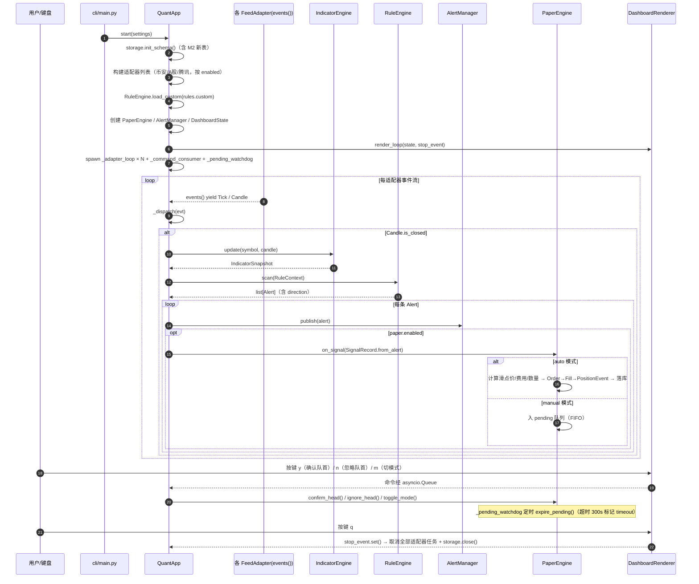
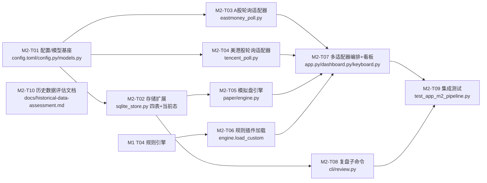

# 量化程序（quant_trading）M2 增量系统设计与任务分解

> 版本：v2.0-M2 ｜ 作者：架构师 高见远（Gao） ｜ 日期：2025-10-24 ｜ 上游输入：`docs/PRD-M2.md` v2.0-M2 + `docs/system_design.md` v1.0（M1 基线）
>
> 本文档为 **M1 之上的增量设计**。M1 已交付能力（币安 WS 行情、4 条内置规则、rich 看板、告警三通道、SQLite alerts/candles）不在本文重述，仅描述 M2 变更/新增部分。配套图表：`docs/class-diagram-m2.mermaid`、`docs/sequence-diagram-m2.mermaid`（第 3、4 节内嵌同内容）。
>
> **设计原则**：最小变更。复用 M1 的 `FeedAdapter` ABC、`models.py` 统一模型、`IndicatorEngine`、`RuleEngine`、`AlertManager`、`DashboardState`/`DashboardRenderer`、`Storage`、`config.py` 三级代理解析；M2 不做任何破坏性改动，M1 既有 308 测试保持全绿。

---

## Part A：系统设计

### 1. 增量方案与框架选型

#### 1.1 M2 核心技术难点与对策

| # | 难点 | 对策（相对 M1 增量） |
|---|---|---|
| M2-D1 | **多适配器并行编排**：币安 WS + A股轮询 + 腾讯轮询三类适配器并行，单适配器异常不能拖垮全局 | `QuantApp` 改为「每适配器一个监督协程 `_adapter_loop(adapter)`」；共享 State/Indicator/Rule/Paper/Alert/Storage 一次性创建并注入；某适配器异常仅该协程按退避重启（监督粒度 = 适配器级），其余照常 |
| M2-D2 | **轮询快照聚合 1min K 线**：A股/美港股 ~3s 轮询，需把离散快照按自然分钟聚合成 `Candle`，与币安 WS 的 `is_closed` 语义对齐 | 每个轮询适配器维护「每 symbol 当前未收盘 Candle」；每次轮询用**数据源时间戳**更新 high/low/close/volume；墙钟分钟翻滚时关闭该 Candle（`is_closed=True`）并开新根。聚合逻辑与 WS 同源进入 `_dispatch` |
| M2-D3 | **延迟数据语义**：腾讯源为延迟约 15min 数据，不得让用户误判实时 | 适配器给 symbol 打 `latency_tag`；`SymbolView` 新增 `market`/`latency_tag`；告警消息前缀 `[延迟约15min]`；触发时间戳一律取数据源时间（非本地接收） |
| M2-D4 | **模拟盘诚实成交**：市价单滑点 + 按市场费率精确计算，结果须与手算逐分对齐 | `PaperEngine` 集中实现：成交价 = 最新价 ± 滑点（bps，不利于成交方）；费率按市场费率表（加密/A股/美股/港股）精确算；`qty` 由 `available_cash * position_pct% / price` 得出，A股向下取整到 100 股；全部浮点对照单测（容差 1e-6） |
| M2-D5 | **双模式 + 人工确认队列**：auto 自动下单 / manual 待确认 FIFO，`y` 确认、`n` 忽略、超时失效 | `PaperEngine` 维护 `pending: deque[SignalRecord]`；manual 模式信号入队；`_command_consumer` 处理 `y`（提交队首）/ `n`（忽略队首）；后台任务按 `confirm_timeout_sec` 扫描过期 → 标记 timeout |
| M2-D6 | **规则插件化**：新增自定义规则仅「新建文件 + 配置登记」，引擎核心零改动 | `RuleEngine.load_custom(list["模块路径:类名"])` 经 `importlib` 动态加载并实例化；错误报清晰中文；内置 4 规则不受影响，自动纳入 CLI 规则面板 |
| M2-D7 | **信号→订单→成交→持仓→盈亏全链路持久化与回放** | 新增 signals/orders/fills/positions 四表 + accounts/positions_current 当前态表；外键 `signal_id`/`order_id` 串联；`review` 子命令按 标的+规则+时间 回放生命周期 |
| M2-D8 | **禁网测试延续**：轮询适配器同样禁止真实网络 | 复用 M1 三层可测：`httpx.MockTransport` 注入 REST 响应；轮询适配器接受可注入的 `http_get` 工厂（测试传伪造协程）；主备切换用 mock 双源响应断言 |

#### 1.2 框架与库选型（与 M1 一致，零新增）

M2 **不引入任何新依赖**。沿用：Python 3.13 asyncio / httpx（MockTransport）/ websockets / pandas + pandas-ta / rich / stdlib sqlite3 + tomllib / pytest（无 pytest-asyncio）。A股/美港股均为 HTTP 轮询，httpx `AsyncClient` + `proxy=` 统一代理即可，无需新的 WS 栈。

#### 1.3 asyncio 任务模型（QuantApp 多适配器改造）

```
QuantApp.start()
 ├─ 初始化：Storage.init_schema（含 M2 新表）→ 各适配器预热（币安 REST；A股可选预热 300 根）→
 │     IndicatorEngine.warmup → RuleEngine（含 load_custom）→ AlertManager → PaperEngine
 ├─ 任务 _adapter_loop(adapter) × N：每适配器一个监督协程
 │     async for evt in adapter.events(): _dispatch(evt)
 │     异常退出 → 记 exc_info → 退避重启（仅该适配器）
 ├─ 任务 _command_consumer：键盘命令（p/r/1-9/q 复用；新增 y/n/m）
 ├─ 任务 _pending_watchdog：manual 模式扫描过期待确认（300s）
 ├─ 任务 render_loop：0.5s 读 DashboardState.snapshot() 渲染
 └─ 线程 KeyboardController：独立线程读键盘 → call_soon_threadsafe 投递命令

_dispatch(evt):
   Tick  → state.update_tick(evt)
   Candle(is_closed):
        snap = IndicatorEngine.update(symbol, candle)
        alerts = RuleEngine.scan(RuleContext(...))
        for a in alerts:
            AlertManager.publish(a)              # 复用 M1 告警链
            if paper.enabled: PaperEngine.on_signal(SignalRecord.from_alert(a))  # M2 新增
```

- **监督粒度**：M1 的「三任务整体监督」升级为「每适配器独立监督 + 命令/渲染/看门狗共享任务」。单一轮询适配器瞬断 60s 内自动恢复，不影响币安 WS 与腾讯轮询。
- **共享无锁**：`DashboardState.snapshot()` 浅拷贝机制沿用，渲染任务只读快照。

#### 1.4 行情缓冲方案（复用 + 扩展）

| 缓冲 | 结构 | 容量 | 用途 |
|---|---|---|---|
| K线窗口 | `RingBuffer[Candle]`（deque maxlen=300） | 300 根/币种 | 指标计算（**按 symbol 维度扩展**：A股/美港股 symbol 也各自占一个窗口，键为 symbol 字符串） |
| 轮询当前根 | `dict[symbol, Candle]`（适配器内） | 自选数 | 聚合未收盘分钟 K 线，翻滚时关闭入链 |
| Tick 环 | `RingBuffer[Tick]`（deque maxlen=512） | 512 笔/币种 | 仅更新最新价展示（同 M1） |
| 告警滚动日志 | `deque(maxlen=100)` | 100 条 | CLI 告警面板（同 M1） |
| 待确认队列 | `deque[SignalRecord]` | 无上限（超时清理） | manual 模式 FIFO 确认 |

#### 1.5 配置管理方案（M2 新增节）

在 `config/config.toml` 中新增 §7（PRD-M2）全部键：`[market.a_share]`、`[market.hk_us]`、`[paper]`（含 `fees` 子表）、`[rules] custom`。`config.py` 的 `Settings` 数据类树扩展对应节点；环境变量覆盖沿用 `QUANT_<节>_<键>` 约定（如 `QUANT_PAPER_MODE`）。3 级代理解析（`resolve_proxy`：QUANT_PROXY > 系统代理 env > config.toml 留空）直接复用，轮询适配器通过它拿 `proxy`。

---

### 2. 文件列表（相对仓库根，仅列出 M2 增量）

```
量化程序/
├── config/
│   └── config.toml                   # 新增 [market.a_share]/[market.hk_us]/[paper]/[rules] 节（M2-T01）
├── src/quant/
│   ├── config.py                     # Settings 扩展 market/paper/rules 节点 + 环境变量覆盖（M2-T01）
│   ├── models.py                     # 新增 SignalRecord/Order/Fill/PositionEvent/Account（M2-T01）
│   ├── app.py                        # QuantApp 多适配器编排 + _dispatch + _pending_watchdog（M2-T07）
│   ├── feeds/
│   │   ├── eastmoney_poll.py         # 【新增】A股轮询适配器（push2 主 / 新浪 hq 备，聚合 1min Candle）（M2-T03）
│   │   └── tencent_poll.py           # 【新增】美港股轮询适配器（qt.gtimg.cn，延迟标注）（M2-T04）
│   ├── paper/
│   │   ├── __init__.py
│   │   └── engine.py                 # 【新增】PaperEngine：账户/滑点/费率/双模式/待确认（M2-T05）
│   ├── scanner/
│   │   ├── base.py                   # RuleResult 增加 direction 字段（M2-T01 微调）
│   │   └── engine.py                 # load_custom 动态加载（M2-T06）；规则面板序号泛化 1-9（M2-T07）
│   ├── storage/
│   │   └── sqlite_store.py           # 扩展 signals/orders/fills/positions/accounts/positions_current（M2-T02）
│   └── cli/
│       ├── dashboard.py              # DashboardState/SymbolView + Renderer 扩展：市场列/延迟/模拟盘区/待确认区（M2-T07）
│       ├── keyboard.py               # 新增 y/n/m 按键投递（M2-T07）
│       ├── main.py                   # argparse 新增 review 子命令路由（M2-T08）
│       └── review.py                 # 【新增】review 子命令实现（M2-T08）
├── tests/
│   ├── test_models_m2.py             # SignalRecord/Order/Fill/PositionEvent/Account 构造与字段（M2-T01）
│   ├── test_storage_m2.py            # 四表 CRUD/索引/查询/重启恢复（M2-T02）
│   ├── test_eastmoney_poll.py        # 解析/聚合/主备切换/退避（MockTransport + 伪造 http_get）（M2-T03）
│   ├── test_tencent_poll.py          # 解析/延迟标注/退避（M2-T04）
│   ├── test_paper_engine.py          # 滑点/费率/双模式/y-n-超时/边界拒绝（对照手算）（M2-T05）
│   ├── test_rule_plugin.py           # 插件加载/示例规则/错误报清晰（M2-T06）
│   ├── test_app_m2_pipeline.py       # 集成：3 伪造适配器并行 + 模拟交易全链路 + review（M2-T09）
│   └── rules_custom_example.py       # 【新增】示例自定义规则（M2-T06）
└── docs/
    ├── system_design_m2.md           # 本文档
    ├── class-diagram-m2.mermaid
    ├── sequence-diagram-m2.mermaid
    └── historical-data-assessment.md # 【新增】P1-6 评估文档（M2-T10）
```

> **不改动列表**（最小变更保证）：`feeds/base.py`、`feeds/binance_ws.py`、`feeds/binance_rest.py`、`indicators/*`、`alerts/manager.py`、`utils/*`、`cli/keyboard.py` 核心线程逻辑。DashboardState 为「扩展字段」而非重写。

---

### 3. 数据结构与接口（M2 增量）

> 完整版见 `docs/class-diagram-m2.mermaid`。新增/变更如下：

#### 3.1 新增数据模型（`models.py`）

```python
@dataclass(slots=True)
class SignalRecord:
    id: int | None            # 自增，落库后回填
    ts_ms: int                # 信号触发时间（= 数据源时间，非本地接收）
    market: str               # crypto / a_share / us / hk（由 symbol 后缀派生）
    symbol: str
    rule: str
    direction: str            # "long" / "close"
    mode: str                 # "auto" / "manual"
    status: str               # pending / ordered / ignored / timeout / no_position
    trigger_value: float
    order_id: int | None = None

@dataclass(slots=True)
class Order:
    id: int | None
    ts_ms: int
    signal_id: int | None
    symbol: str
    side: str                 # "buy" / "sell"
    qty: float
    ref_price: float          # 信号触发参考价（最新价）
    status: str               # filled / rejected
    reason: str | None = None # 拒绝原因（资金不足/无持仓等）

@dataclass(slots=True)
class Fill:
    id: int | None
    order_id: int
    ts_ms: int
    symbol: str
    qty: float
    fill_price: float         # 含滑点后成交价
    fee: float
    amount: float             # qty * fill_price

@dataclass(slots=True)
class PositionEvent:
    id: int | None
    ts_ms: int
    symbol: str
    event: str                # open / reduce / close
    qty: float
    price: float
    realized_pnl: float = 0.0

@dataclass(slots=True)
class Account:
    market: str               # crypto / a_share / us / hk
    cash: float               # 可用现金（计价货币）
    realized_pnl: float = 0.0
```

#### 3.2 `RuleResult` / `Alert` 增量

- `RuleResult` 新增可选字段 `direction: str | None = None`。4 条内置规则按 D8 设定方向：
  - `PriceMoveRule`：上涨 → `"long"`，下跌 → `"close"`
  - `VolumeSpikeRule`：量突增 → `"long"`
  - `RsiRule`：超卖 → `"long"`，超买 → `"close"`
  - `MaCrossRule`：金叉 → `"long"`，死叉 → `"close"`
- `Alert` 新增 `direction` 字段（由 RuleResult 透传），供 `PaperEngine.on_signal` 读取与 `AlertManager` 生成 `[延迟约15min]` 前缀判断。

#### 3.3 `FeedAdapter` 实现扩展（新增两个具体适配器）

| 适配器 | 数据源 | 关键行为 |
|---|---|---|
| `EastmoneyPollAdapter` | push2.eastmoney.com（主）/ hq.sinajs.cn（备） | 构造批量行情 URL → `httpx.AsyncClient(proxy=...)` 轮询 → 解析快照 → 按自然分钟聚合 Candle；主源连败 ≥3 次切备源、成 1 次切回；可选预热拉 300 根 1min K 线 |
| `TencentPollAdapter` | qt.gtimg.cn（单源） | 同轮询范式；每 symbol 标记 `latency_tag="~15min"`；冷启动前 25min 仅积累不触发（状态栏「预热中」） |

两者均可注入 `http_get` 工厂（签名 `async def http_get(url, params) -> str`）以便测试用伪造协程替代真实 httpx。

#### 3.4 `PaperEngine`（`paper/engine.py`）接口约定

```python
class PaperEngine:
    def __init__(self, settings, storage): ...
    def on_signal(self, sig: SignalRecord) -> None     # auto 直接提交；manual 入 pending
    def confirm_head(self) -> None                      # y：提交队首待确认
    def ignore_head(self) -> None                       # n：忽略队首
    def expire_pending(self) -> None                    # 看门狗：超时标记 timeout
    def toggle_mode(self) -> str                        # m：auto<->manual 运行时切换
    def accounts_view(self) -> dict[str, AccountView]   # 供看板模拟盘区
    def pending_view(self) -> list[SignalRecord]        # 供看板待确认区
```

- 成交价：`buy → ref_price * (1 + slippage_bps/1e4)`；`sell → ref_price * (1 - slippage_bps/1e4)`。
- 费用（按 market 取费率表）：加密 taker 0.1%；A股 佣金 0.025%（双边）+ 卖出印花税 0.1% + 过户费 0.001%；美股 0；港股 佣金 0.03% + 印花税 0.1%（双边）。
- 下单规模：`qty = floor(available_cash * position_pct/100 / fill_price)`；A股 `qty = floor(qty/100)*100`。
- 约束：单标的单仓位（`one_position_per_symbol`）；long 时已有持仓 → 记 `ignored`；close 时无持仓 → 记 `no_position`；现金不足 / qty≤0 → Order `rejected` + reason。
- 持久化：每个 Fill 后事务更新 `accounts`（cash/realized_pnl）与 `positions_current`（开/平）；事件落 `signals/orders/fills/positions`。

#### 3.5 `Storage` 扩展（`storage/sqlite_store.py`）

新增 DDL（索引覆盖查询路径）：

| 表 | 关键字段 | 索引 |
|---|---|---|
| signals | id, ts_ms, market, symbol, rule, direction, mode, status, trigger_value, order_id | (symbol), (rule), (ts_ms) |
| orders | id, ts_ms, signal_id, symbol, side, qty, ref_price, status, reason | (symbol), (ts_ms) |
| fills | id, order_id, ts_ms, symbol, qty, fill_price, fee, amount | (symbol), (ts_ms) |
| positions | id, ts_ms, symbol, event, qty, price, realized_pnl | (symbol), (ts_ms) |
| accounts | market(PK), cash, realized_pnl | — |
| positions_current | symbol(PK), market, qty, avg_cost, opened_ts | (market) |

- `save_signal/save_order/save_fill/save_position/save_account/update_position_current` 方法。
- `query_signals(symbol, rule, start_ms, end_ms, limit)`、`query_trade_lifecycle(symbol)`（按 signal_id 串联 orders→fills→positions）、`account_summary(market)`（供 `--account`）。
- 重启恢复：启动时 `load accounts` + `positions_current` 重建内存态。

#### 3.6 `DashboardState` / `DashboardRenderer` 扩展

- `SymbolView` 新增 `market: str`、`latency_tag: str = ""`。
- `DashboardState` 新增 `paper_accounts: dict[str, AccountView]`、`pending: deque[SignalRecord]`、`paper_mode: str`。
- 渲染四区改造：
  - **状态栏**：逐适配器 `币安 WS●` / `A股 轮询●~3s` / `腾讯 轮询●~3s ⏱约15min` + `[manual]/[auto]`。
  - **行情表**：新增「市场」列；美港股行级 `⏱约15min`。
  - **告警日志**：美港股 `[延迟约15min]` 前缀；manual `[待确认 y/n]`。
  - **模拟盘区（新增）**：分市场 现金/持仓市值/浮动盈亏/已实现盈亏/未平仓数。
  - **待确认区（新增）**：符号/规则/方向/触发值/剩余超时，`y`/`n` 操作。
  - **规则面板**：自定义规则自动纳入；序号键泛化 1-9。

---

### 4. 程序调用流程（M2 增量）

> 完整版见 `docs/sequence-diagram-m2.mermaid`。关键分支：



**流程要点**：
1. **统一入口 `_dispatch`**：三种适配器经同一分发函数进入指标/规则/告警/模拟盘链，规则与指标零市场分支（D1/D2）。
2. **延迟语义**：腾讯适配器在 Candle/Alert 上打 `latency_tag` 与 `[延迟约15min]` 前缀，时间戳取数据源时间。
3. **双模式解耦**：auto 在 `on_signal` 内同步落库；manual 仅入队，由键盘 `y/n` 与看门狗驱动，避免阻塞行情主链。

---

### 5. 待明确事项（附默认建议，工程师按此执行除非用户否决）

| # | 事项 | 默认建议 |
|---|---|---|
| MU1 | A股预热是否默认开启 | 默认开启（拉最近 300 根 1min K 线）；失败降级冷启动，状态栏「预热中」，不阻塞启动 |
| MU2 | 轮询适配器 `http_get` 注入点 | 构造签名 `async def http_get(url: str, params: dict) -> str`；生产用 `httpx.AsyncClient(proxy=resolve_proxy())`，测试注入伪造协程 |
| MU3 | 账户当前态表 vs 事件聚合 | 采用「`accounts` + `positions_current` 当前态表」方案（查询快、review --account 直接读），与事件表双写保证可回放 |
| MU4 | 信号方向来源 | 由 `RuleResult.direction` 透传至 `Alert` 与 `SignalRecord`；插件规则自行声明 direction（缺省 None → 不进模拟盘） |
| MU5 | `m` 运行时切模式（M2-P1） | 经 `PaperEngine.toggle_mode()` 改内存态 + 落 config 快照；降级方案为「改 config + 重启」不影响 M2-P0 |
| MU6 | 美港股非交易时段 | 轮询照常（~3s），数据静止无新分钟收盘，规则自然不触发；状态栏标注数据源可达性即可 |
| MU7 | 自定义规则目录约定 | 放 `src/quant/scanner/rules_custom_example.py` 作为示例；`[rules.custom]` 登记 `"quant.scanner.rules_custom_example:MyRule"`；加载失败报「规则 X 加载失败：{异常}」 |

---

## Part B：任务分解

### 6. 依赖包清单（M2 零新增）

沿用 M1：`websockets / httpx / pandas / pandas-ta / rich / pytest`。M2 不引入新依赖；A股/美港股轮询复用 httpx 异步客户端与 MockTransport。

### 7. 任务列表（按实现顺序，共 10 个任务；任务即 commit 单元）

#### M2-T01 配置与模型基座扩展

- **目标**：落地 M2 全部配置键与新增数据模型，为后续任务提供类型与配置基座。
- **Source Files**：`config/config.toml`（新增 §7 全部节）、`src/quant/config.py`（Settings 扩展 market/paper/rules 节点 + env 覆盖）、`src/quant/models.py`（新增 5 个 dataclass + `RuleResult.direction`/`Alert.direction`）、`src/quant/scanner/base.py`（`RuleResult` 增加 `direction`）、`tests/test_models_m2.py`、`tests/test_config.py`（扩展 M2 键断言）。
- **Dependencies**：M1 T01/T02
- **Priority**：P0
- **验收标准**：`--check-config` 打印 M2 生效配置（代理脱敏、paper.mode、initial_cash、fees 表）；5 个新 dataclass 构造与字段单测全覆盖；M1 既有测试全绿。

#### M2-T02 存储层扩展（四表 + 当前态）

- **目标**：实现 signals/orders/fills/positions/accounts/positions_current 六表 CRUD 与查询。
- **Source Files**：`src/quant/storage/sqlite_store.py`（DDL + 方法）、`tests/test_storage_m2.py`（tmp_path；四表写入+按 symbol/rule/ts_ms 过滤；account_summary；重启恢复）。
- **Dependencies**：M2-T01
- **Priority**：P0
- **验收标准**：索引覆盖查询路径，按 标的+规则+时间 查询 < 1s（SQLite 本地）；进程重启账户/持仓态可恢复；重复写入幂等；测试全绿。

#### M2-T03 A股轮询适配器（P1-1）

- **目标**：实现东财 push2 主 / 新浪 hq 备 的轮询适配器，聚合 1min Candle。
- **Source Files**：`src/quant/feeds/eastmoney_poll.py`、`tests/test_eastmoney_poll.py`（MockTransport 解析 + 聚合翻滚 + 主备切换 mock 双源 + 退避序列 + 预热路径）。
- **Dependencies**：M2-T01、M2-T02
- **Priority**：P0
- **验收标准**：字段完整（价/量/数据源时间）；主备切换有测试覆盖；退避 1→30s 封顶；预热失败降级冷启动；全程零真实网络；测试全绿。

#### M2-T04 美股/港股轮询适配器（P1-2）

- **目标**：实现腾讯 qt.gtimg.cn 轮询适配器，强制延迟标注。
- **Source Files**：`src/quant/feeds/tencent_poll.py`、`tests/test_tencent_poll.py`（解析 + `latency_tag`/告警前缀断言 + 退避）。
- **Dependencies**：M2-T01、M2-T02
- **Priority**：P0
- **验收标准**：延迟标注三处（状态栏/行情表/告警）语义在数据与单测中可见；冷启动前 25min 仅积累不触发；测试全绿。

#### M2-T05 模拟盘引擎（P1-3）

- **目标**：实现虚拟账户、滑点/费率精确计算、双模式、待确认队列、盈亏。
- **Source Files**：`src/quant/paper/engine.py`、`src/quant/paper/__init__.py`、`tests/test_paper_engine.py`（滑点/费率对照手算 1e-6；auto/manual y/n/超时全覆盖；边界拒绝落库）。
- **Dependencies**：M2-T01、M2-T02
- **Priority**：P0
- **验收标准**：一笔完整交易（信号→订单→成交→持仓→平仓→已实现盈亏）可串联；费用/滑点逐分对齐手算；双模式 + 边界拒绝全部落库有原因；测试全绿。

#### M2-T06 规则插件加载（P1-5）

- **目标**：`RuleEngine.load_custom` 动态加载自定义规则，零核心改动。
- **Source Files**：`src/quant/scanner/engine.py`（load_custom）、`tests/rules_custom_example.py`、`tests/test_rule_plugin.py`（加载成功 + 错误报清晰 + 自定义规则纳入 signals）。
- **Dependencies**：M1 T04
- **Priority**：P1
- **验收标准**：新增 1 条规则仅「新建文件 + 配置登记」两处；示例规则 + 加载测试；加载失败报错信息清晰；测试全绿。

#### M2-T07 多适配器编排 + 看板改造（M2-X1 + P1-3 UI）

- **目标**：`QuantApp` 多适配器监督编排；看板市场列/延迟/模拟盘区/待确认区；`y/n/m` 按键。
- **Source Files**：`src/quant/app.py`（多适配器 `_adapter_loop` + `_dispatch` + `_pending_watchdog`）、`src/quant/cli/dashboard.py`（扩展 State/View/Renderer）、`src/quant/cli/keyboard.py`（y/n/m）、`src/quant/scanner/engine.py`（规则面板序号泛化 1-9）。
- **Dependencies**：M2-T03、M2-T04、M2-T05、M2-T06
- **Priority**：P0
- **验收标准**：≥3 适配器并行、单适配器异常不影响其他；看板新增区域全部渲染；`y/n/m` 不阻塞数据流；M1 测试全绿。

#### M2-T08 复盘子命令（P1-4）

- **目标**：`python -m quant review` 按 标的/规则/时间 回放生命周期 + `--account` 汇总。
- **Source Files**：`src/quant/cli/review.py`、`src/quant/cli/main.py`（argparse 子命令）、`tests/test_review.py`（构造 信号→订单→成交→平仓 样本，断言输出 table/json/csv）。
- **Dependencies**：M2-T02
- **Priority**：P0
- **验收标准**：按 标的+规则+时间 查询响应 < 1s；全链路可串联回放；CSV/JSON 导出复用 M1 能力；测试全绿。

#### M2-T09 集成测试与全链路回放（出口验证）

- **目标**：伪造 3 适配器并行驱动 QuantApp，跑通「行情→指标→规则→告警→模拟交易→复盘」全链路。
- **Source Files**：`tests/test_app_m2_pipeline.py`（3 伪造适配器 + MockTransport 预热 → 跑数秒 → 断言 alerts.jsonl 落盘 + 模拟交易四表串联 + review 输出）。
- **Dependencies**：M2-T07、M2-T08
- **Priority**：P0
- **验收标准**：零真实网络跑通；一笔模拟交易全生命周期可回放演示；M1+M2 全测试绿。

#### M2-T10 历史数据评估文档（P1-6）

- **目标**：输出 `docs/historical-data-assessment.md`，评估 akshare 与自建存储支撑 M3 回测可行性（仅评估，不实现回测；akshare 不入运行时依赖）。
- **Source Files**：`docs/historical-data-assessment.md`。
- **Dependencies**：无（可并行）
- **Priority**：P1
- **验收标准**：覆盖来源可用性/字段完整性/存储成本三要素 + 实测记录；结论明确 M3 数据源选型建议。

---

### 8. 共享知识（跨文件约定，工程师必读）

**复用 M1 约定**（不重复造轮子）：
- 时间：内部 epoch ms（UTC）；`timeutils.to_iso(ms)` 展示；存储 UTC。
- 代理：`resolve_proxy()` 三级优先级；轮询适配器 `httpx.AsyncClient(proxy=resolve_proxy())`。
- 测试禁网：WS/REST 用 connector 注入 / MockTransport；轮询用 `http_get` 注入伪造协程；网络类测试打 `@pytest.mark.network` 默认排除。
- 异步测试沿用 `asyncio.run()` 外裹（不引 pytest-asyncio）；时间相关测试注入固定 epoch ms。
- Git：每任务一 commit，`<type>(<scope>): <中文描述>`；禁提交 `.env/*.db/*.log/data/` 运行时产物。
- 数据源白名单（D7）：币安仅 `.vision`；A股 = push2.eastmoney.com + hq.sinajs.cn；美港股 = qt.gtimg.cn；**tdx-connector 禁用**；akshare 仅评估、不入运行时依赖。

**M2 新增约定**：
- symbol 后缀派生 market：`USDT` 结尾→crypto；`.SH`/`.SZ`→a_share；`.HK`→hk；`.US`→us（与 D3 一致）。
- 滑点方向不利于成交方（buy 价升、sell 价降）；费率按 market 取 `paper.fees` 表。
- 信号方向由 `RuleResult.direction` 透传；`None` 规则不进模拟盘。
- 仅多头，不做空、不加仓、不止损止盈（M2 范围外）。

### 9. 任务依赖图



- 关键路径：T01 → T02 → T05 → T07 → T09（模拟盘链路）；T03/T04 与 T05 并行汇入 T07。
- 每个任务完成即 commit 并保证 `pytest` 全绿；T09 完成后 M2 出口标准（P1-1~P1-6 + M2-P1 项）达成。

---

*本文档为 M2 增量架构基线；M1 内容以 `docs/system_design.md` v1.0 与已交付代码为准。*
